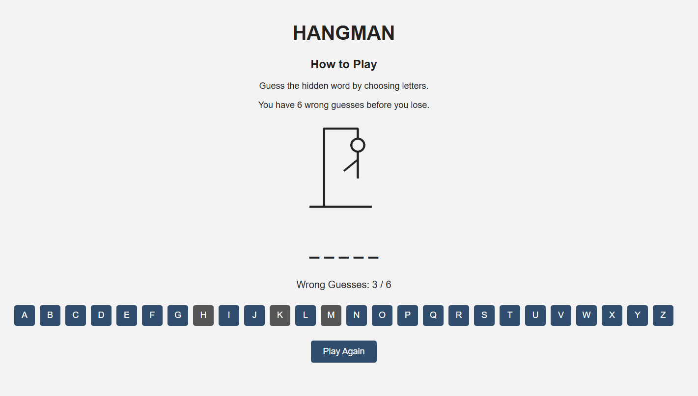
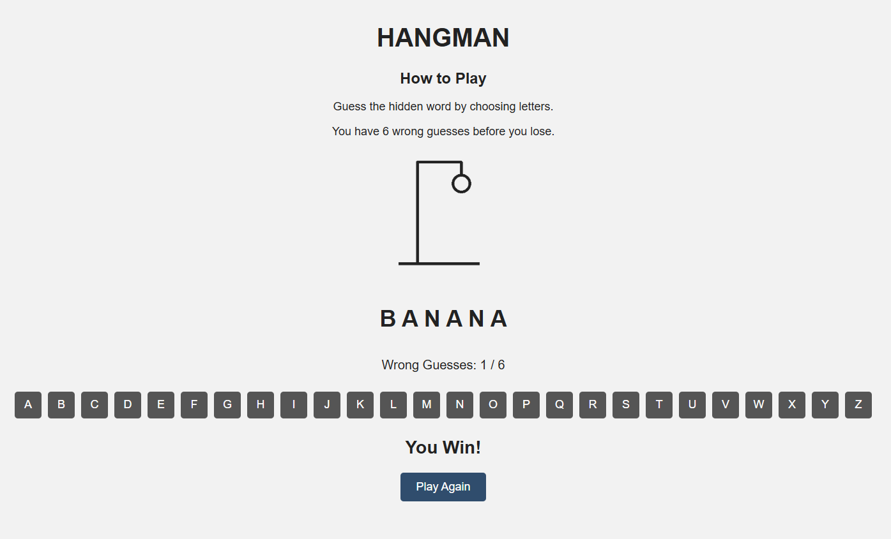
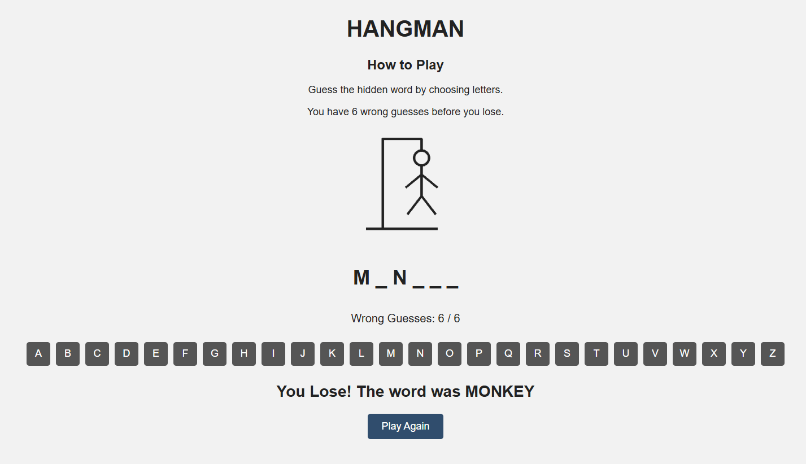

# Hangman Game

## Technologies Used
1. HTML
2. CSS
3. JavaScript

## Description
Hangman is a word guessing game where the player tries to guess a randomly selected word by clicking letters. Correct guesses reveal the letters in the word, while incorrect guesses add parts to the Hangman drawing. The player has 6 wrong guesses before losing.

## User Stories
1. As a user, I want to guess a randomly selected word using the alphabet buttons.

2. As a user, I want correct guesses to reveal letters in the hidden word.

3. As a user, I want incorrect guesses to increase the wrong guess counter and update the Hangman drawing.

4. As a user, I want selected letters to be disabled so I cannot guess the same letter twice.

5. As a user, I want to see a win or lose message and restart the game using the Play Again button.

## Screenshots

### Gameplay

### Winning

### Losing

## Technologies Used
- HTML
- CSS
- JavaScript

## Future Enhancements
1. Difficulty levels
2. Sound effects
3. More word categories

## Credits

Created by Ali Alalwan